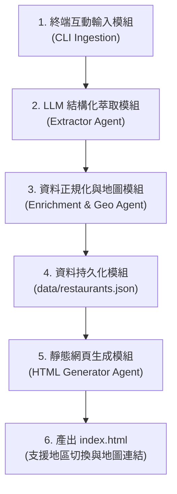

# 美食推薦整合器 (Food Recommendation Aggregator) - 系統開發規格與協作指引 (AGENTS.md)

本文件定義「美食推薦整合器」的系統架構、資料規範、工作流程與各代理人（Agent）/ 模組的角色職責，作為開發與執行的最高準則。

---

## 1. 專案目標與使用場景 (Project Overview)

### 1.1 核心目標
建立一個能將社群平台（Instagram / Threads）美食貼文轉化為結構化資訊的整合工具。使用者透過終端機輸入貼文連結與複製的內文，系統運用 LLM 自動萃取關鍵資訊，生成手機直覺可開的 Google Maps 導航連結，並自動更新或輸出具有地區分類篩選功能的 `index.html` 響應式網頁。

### 1.2 輸入與輸出規格
* **輸入**：
  1. 貼文來源網址（Instagram 或 Threads 連結）。
  2. 貼文複製之內文文字（使用者直接貼上貼文正文）。
* **輸出**：
  1. 結構化資料庫：`data/restaurants.json`。
  2. 前端展示網頁：`index.html`（具備現代化 UI、地區/縣市分類標籤、關鍵字搜尋、手機 RWD 卡片、直開 Google Maps App）。

---

## 2. 系統架構與資料流 (Architecture & Pipeline)



---

## 3. 資料結構規格 (Data Schema)

儲存於 `data/restaurants.json` 中的單筆餐廳資料格式必須遵循以下 JSON Schema：

```json
{
  "id": "rest_20261116_001",
  "name": "富霸王豬腳",
  "city": "台北市",
  "district": "中山區",
  "address": "台北市中山區南京東路二段115巷20號",
  "recommended_dishes": [
    "腿庫飯",
    "魯肉飯",
    "筍絲"
  ],
  "price_range": "NT$ 100 - 250",
  "post_url": "https://www.threads.net/@example/post/xxxxxx",
  "source_platform": "threads",
  "google_maps_url": "https://www.google.com/maps/search/?api=1&query=%E5%AF%8C%E9%9C%B8%E7%8E%8B%E8%B1%AC%E8%85%B3+%E5%8F%B0%E5%8C%97%E5%B8%82%E4%B8%AD%E5%B1%B1%E5%8D%80%E5%8D%97%E4%BA%AC%E6%9D%B1%E8%B7%AF%E4%BA%8C%E6%AE%B5115%E5%85%B720%E8%99%9F",
  "raw_content": "這家真的台北最強豬腳...",
  "notes": "排隊名店，建議中午早點去",
  "created_at": "2026-11-16T22:30:00+08:00"
}
```

### 欄位規範說明：
* `city`：縣市名（如「台北市」、「新北市」、「台中市」、「台南市」等）。
* `district`：行政區或鄉鎮市區（如「大安區」、「西區」）。若貼文無詳細區域名，填寫「其他」或根據地址推斷。
* `google_maps_url`：必須使用官方 Universal URL 格式：
  `https://www.google.com/maps/search/?api=1&query={urlencoded_query}`
  其中 `{urlencoded_query}` 應為 `urllib.parse.quote(f"{name} {address}")`。
* `price_range`：若貼文無提及價位，填寫 `"未註明（依現場菜單為準）"`。
* `recommended_dishes`：陣列，萃取貼文推薦之具體品項名稱。

---

## 4. 代理人與模組職責劃分 (Module & Agent Roles)

### 4.1 CLI Ingestion Module (`cli.py`)
* **職責**：
  * 啟動互動式命令列界面，引導使用者依序輸入貼文網址與貼文內文。
  * 支援多行文字輸入（例如按特定的結束字元或空行確認）。
  * 簡易前置檢查（驗證 URL 格式是否為 Instagram 或 Threads 網址）。

### 4.2 LLM Extractor Agent (`extractor.py`)
* **職責**：
  * 調用 LLM（如 Google Gemini API）進行非結構化文字剖析。
  * 規範輸出使用 JSON 格式（Structured Outputs），防止自由發揮造成解析失敗。
* **Prompt 指引**：
  * 扮演專業的美食資訊架構師。
  * 嚴格從貼文中找出：店名、詳細地址、城市、行政區、推薦品項清單、價格資訊與心得備註。
  * 若貼文只寫「在xx捷運站附近」而無具體地址，需將地標/捷運站帶入地址欄位並註明。

### 4.3 Enrichment & Storage Module (`storage.py`)
* **職責**：
  * 產生唯一 UUID / 時間戳 ID。
  * 組合並以 URL 編碼產出標準 Google Maps Universal Search 連結。
  * 讀取現有的 `data/restaurants.json`，進行增量寫入（若網址重複則提醒是否覆蓋或更新）。
  * 維護資料寫入的交易安全與備份。

### 4.4 Web Generator Agent (`generator.py`)
* **職責**：
  * 讀取 `data/restaurants.json` 並產生獨立可離線瀏覽的 `index.html`。
  * 使用現代美觀的 CSS 框架（如 CDN 引入 Tailwind CSS 或內嵌式 CSS，無需複雜前端編譯環境）。
* **UI/UX 規範**：
  * **地區篩選 (Filter Tabs / Dropdown)**：
    * 頂部列出所有出現過的「城市 / 地區」標籤（如：全部、台北市大安區、台中市西區...），點擊即時過濾顯示。
  * **關鍵字搜尋 (Search Bar)**：
    * 支援店名、餐點品項即時搜尋（純前端 JavaScript 實作）。
  * **美食卡片 (Card Layout)**：
    * 店名與來源標籤（IG / Threads）。
    * 推薦餐點 Tag。
    * 價位區間。
    * 醒目的「在 Google Maps 中開啟」按鈕（手機點擊喚起 Google Maps App，電腦點擊開新分頁）。
    * 原始貼文連結（點擊返回原文查看照片）。
  * **手機響應式 (Mobile Responsive)**：卡片在手機單欄、平板/電腦多欄網格呈現。

---

## 5. 邊界情況與防呆機制 (Edge Cases & Fallbacks)

| 情境 | 處理策略 |
| :--- | :--- |
| **貼文完全未提供地址** | 1. 地址欄位填入「貼文未提及，建議搜尋店名確認」。<br>2. Google Maps URL query 僅使用 `{店名}` 進行搜尋。 |
| **貼文有多家分店** | 萃取貼文特別指名之分店；若未指名，地址填入「連鎖門市」，地圖 query 採用 `{店名}`。 |
| **貼文無提及價位** | 統一填入 `"未註明（依現場菜單為準）"`，不胡亂猜測。 |
| **重複輸入相同貼文** | 檢查 `post_url` 是否已存在於 `restaurants.json`，若存在則詢問使用者是否更新。 |
| **LLM 回應非合法 JSON** | 設計 Retry 邏輯（最多 2 次），若失敗則記錄錯誤日誌並保留原文供手動檢閱。 |

---

## 6. 建議目錄結構 (File Structure)

```
.
├── AGENTS.md                 # 本系統規格與指引文件
├── requirements.txt          # Python 依賴清單 (google-genai / requests / jinja2 等)
├── main.py                   # 程式入口 (CLI 流程控制)
├── config.py                 # 環境變數與 API Key 設定
├── modules/
│   ├── __init__.py
│   ├── extractor.py          # LLM 結構化剖析模組
│   ├── storage.py            # 資料儲存與 Maps 連結處理
│   └── generator.py          # HTML 靜態網頁渲染器
├── templates/
│   └── index_template.html   # 響應式網頁 HTML 模板 (Jinja2)
├── data/
│   └── restaurants.json      # 核心餐廳資料庫 (JSON 格式)
└── index.html                # 最終生成的公開瀏覽網頁
```

---

## 7. 驗收標準與開發里程碑 (Milestones & Acceptance Criteria)

- [ ] **M1: 基礎環境與 CLI 輸入**
  - 使用者能執行 `python main.py`，順暢貼入網址與多行貼文文字。
- [ ] **M2: LLM 結構化萃取測試**
  - 給定實體 IG/Threads 貼文內文，能正確辨識店名、推薦品項、價錢、地址與縣市區域。
- [ ] **M3: 資料持久化與 Maps 連結驗證**
  - 資料正確 Append 到 `data/restaurants.json`。
  - Google Maps 連結點擊後能精確載入地圖搜尋結果。
- [ ] **M4: index.html 渲染與前端互動驗收**
  - 產出的 `index.html` 雙擊即可在瀏覽器打開。
  - 具備地區切換按鈕、搜尋框、卡片響應式排版，樣式現代俐落。
